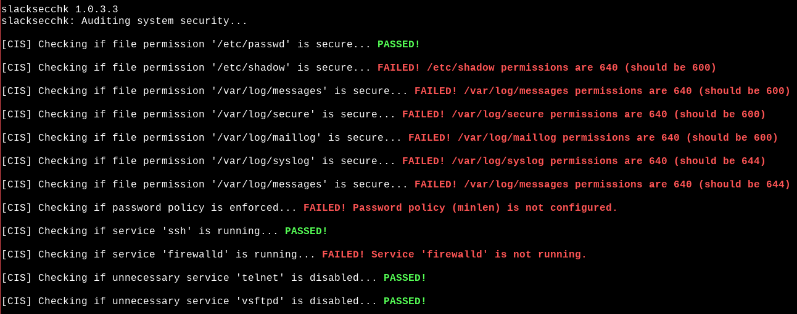

# SlackSecChk

SlackSecChk is a C-based security-audit utility for Slackware Linux. It checks a selected set of system files and configuration settings against security-hardening recommendations.

[](https://github.com/Yousha/slacksecchk/actions/workflows/action.yml) [](https://github.com/Yousha/slacksecchk/actions/workflows/dependabot/dependabot-updates) [](https://github.com/Yousha/slacksecchk/actions/workflows/github-code-scanning/codeql)

> **Scope:** This project is an audit helper, not a complete CIS benchmark or NSA/DISA STIG compliance scanner. Its checks are selective and may require review for the target Slackware release and local system policy. A passing result does not certify compliance.

## Features

- Checks permissions on selected system files and directories.
- Reviews selected password and account-policy settings.
- Checks selected services, packages, logging, SSH, firewall, and kernel settings.
- Uses Slackware package records and `/etc/rc.d` service scripts where applicable.
- Detects active UFW, firewalld, nftables, and iptables filtering, and checks Slackware boot-time firewall enablement.
- Provides a small C codebase intended to be extended with additional checks.

## Requirements

- Slackware Linux (the checks are intended for Slackware; other distributions are not currently supported).
- GCC and GNU Make to build from source.
- Root privileges are recommended when running the audit so checks can read protected system files and inspect system state.

## Screenshots



## Build

Clone the repository:

```bash
git clone https://github.com/Yousha/slacksecchk.git
cd slacksecchk
```

Build the executable:

```bash
make
```

The executable is created at `artifacts/slacksecchk`.

Useful Make targets:

| Command | Description |
| --- | --- |
| `make` | Build the optimized executable. |
| `make debug` | Clean and build with debug symbols. |
| `make clean` | Remove generated build files. |
| `make test` | Run the smoke tests (builds first if needed). |
| `make checksums` | Generate a fresh `Checksums.sha256` manifest for the working tree. |
| `sudo make install` | Install to `/usr/local/bin/slacksecchk` (requires root privileges). |
| `sudo make uninstall` | Remove the installed executable (requires root privileges). |

## Usage

Run the executable from the repository:

```bash
sudo ./artifacts/slacksecchk
```

Or, after installation:

```bash
sudo slacksecchk
```

The program prints the result of each configured check. Output labels have the following meaning:

- **PASSED**: The check's configured condition was met.
- **FAILED**: The check reported a condition that needs review.
- **Notice/Error**: The check could not fully verify the condition or the required configuration was unavailable.

These labels describe the current implementation; they should not be interpreted as proof of overall system security or benchmark compliance.

## Checksums

The checksum manifest is generated from the current working tree. After running `make checksums`, verify it from the repository root with:

```bash
sha256sum -c Checksums.sha256
```

Regenerate the manifest after changing project files.

## Testing

Build and run the smoke tests with:

```bash
make test
```

The current tests verify that the executable starts and completes an audit run. The smoke test stubs recursive filesystem searches so CI does not audit the runner host. It does not validate the correctness of individual security checks.

## CI

GitHub Actions runs on pushes and pull requests targeting `main`. The workflow checks out the repository, lints YAML files, builds with GCC on Ubuntu, and runs the smoke tests.

This CI job validates the build and basic execution path on Ubuntu; it does not replace testing on supported Slackware releases.

## Slackware compatibility

Slackware uses SysV-style startup scripts rather than systemd. Service checks therefore inspect daemon processes and `/etc/rc.d/rc.*` executable bits instead of calling `systemctl` or the generic `service` command. The firewall check detects active UFW, firewalld, nftables, or iptables filtering rules and separately verifies the relevant Slackware startup hook (`rc.firewall` or `rc.firewalld`). Slackware's standard `sysklogd` (`syslogd`) and `ntpd` are recognized. Optional components that are not part of a standard Slackware installation, such as auditd, SELinux/AppArmor, and Red Hat crypto-policies, are reported as not applicable when absent.

## Contributing

Contributions are welcome. Please create a feature branch, include tests for behavior changes, and open a pull request.

## License

This project is licensed under the GPL-3.0. See [LICENSE](LICENSE) for details.

## Contact

For questions or feedback, please use the [GitHub issues](https://github.com/Yousha/slacksecchk/issues) page.
